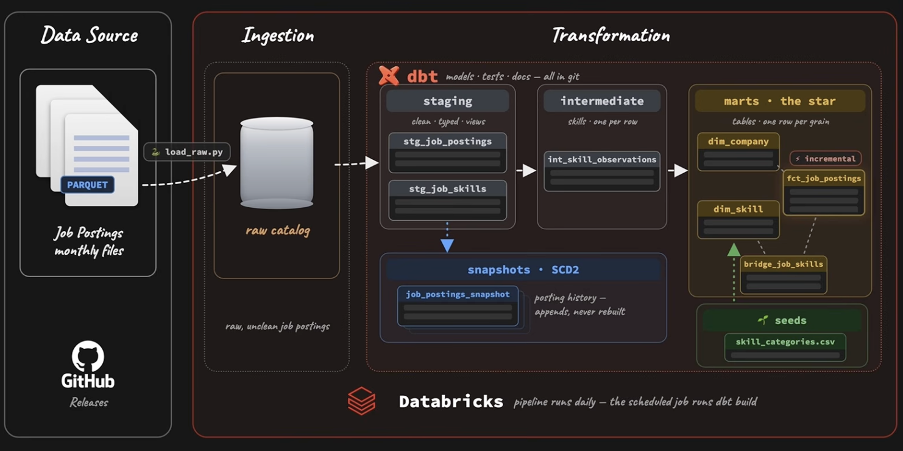
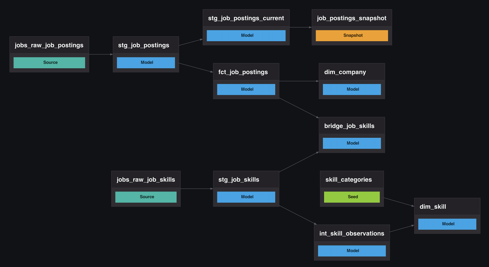
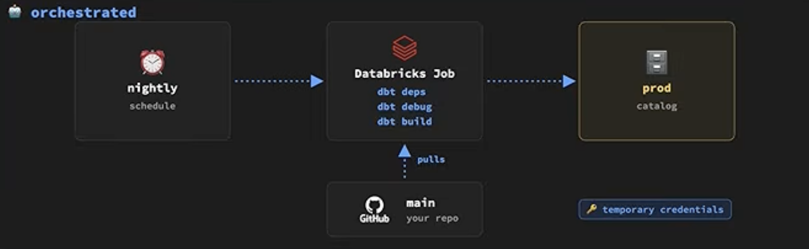
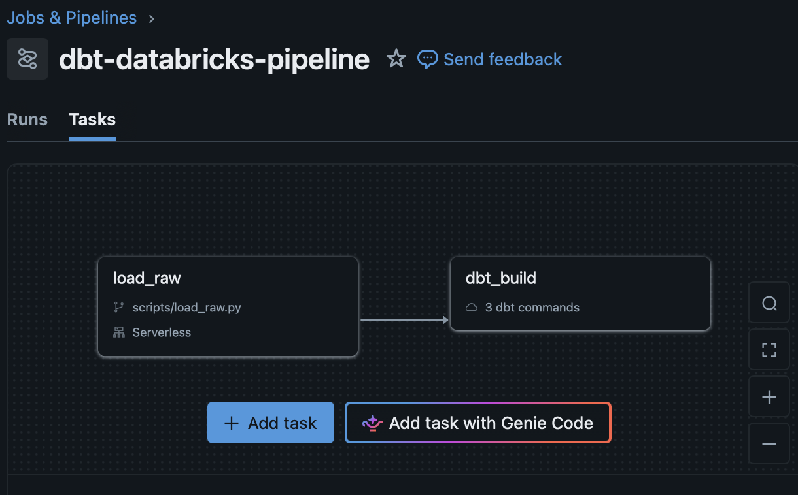

# 🚀 dbt Databricks Pipeline


End-to-end ELT pipeline on **Databricks + dbt** for ingesting job posting data, transforming it through layered models, and publishing analytics-ready marts.



🔗 **Live dbt Docs**: https://sumaaithal.github.io/dbt-databricks-pipeline/#/resource/model/?modeling_layer=Staging

---

## 📚 Table of Contents

- [📌 Project Overview](#-project-overview)
- [🧰 Prerequisites](#-prerequisites)
- [🏗️ Architecture](#️-architecture)
- [🧱 Repository Structure](#-repository-structure)
- [🧩 Model-by-Model Details](#-model-by-model-details)
- [🔄 Pipeline Orchestration (Databricks Jobs)](#-pipeline-orchestration-databricks-jobs)
- [▶️ Run Order](#️-run-order)
- [✅ Data Quality & Governance](#-data-quality--governance)
- [📊 Lineage](#-lineage)
- [🖼️ Figures](#️-figures)
- [🧪 Local Development](#-local-development)
- [🚀 Deployment Notes](#-deployment-notes)
- [🛠️ Troubleshooting](#️-troubleshooting)
- [👤 Author](#-author)

---

## 📌 Project Overview

This repository implements a modern analytics engineering workflow with:

- **Databricks catalogs** for environment separation:
  - `raw` → ingestion/landing data
  - `dev` → development + validation
  - `prod` → production-ready models
- **dbt model layers**:
  - `staging` (`stg_*`)
  - `intermediate` (`int_*`)
  - `marts` (`fct_*`, `dim_*`, `bridge_*`)
- **Snapshot/backfill logic** for historical tracking
- **Automated jobs** in Databricks:
  - **Load Job** (ingestion)
  - **Transformation Job** (dbt run/test/snapshot)
- **Scheduled trigger**: runs **once every 4 weeks**

---

## 🧰 Prerequisites

- **dbt Core**: `1.8+` (recommended for unit-test features and latest docs behavior)
- **dbt-databricks adapter**: compatible with your dbt Core version
- **Databricks Runtime**: `13.x+` (recommended `14.3 LTS+`)
- **Python**: `3.10+`
- **Graphviz**: required for lineage PNG/SVG rendering (`dot` command)

Install Graphviz on Mac:
```bash
brew install graphviz
```

---

## 🏗️ Architecture

```text
Raw Source → Databricks raw catalog → dbt staging → dbt intermediate → dbt marts → BI/Consumption
```

### Medallion mapping
| Layer | dbt models | Purpose |
|---|---|---|
| Bronze | `staging` (`stg_*`) | Cleaned, standardised raw data |
| Silver | `intermediate` (`int_*`) | Deduplicated, normalised entities |
| Gold | `marts` (`fct_*`, `dim_*`, `bridge_*`) | Analytics-ready facts and dimensions |

### Environment/Catalog Strategy
- `raw`: source-aligned landing zone
- `dev`: iterative model development and testing
- `prod`: governed production datasets

---

## 🧱 Repository Structure

```text
dbt-databricks-pipeline/
├── analytics/
│   ├── models/
│   │   ├── staging/
│   │   ├── intermediate/
│   │   └── marts/
│   ├── macros/
│   ├── snapshots/
│   ├── tests/
│   ├── scripts/
│   ├── dbt_project.yml
│   └── lineage.py
├── scripts/
│   └── backfill_job_postings_snapshot.sql
└── README.md
```

✅ `lineage.py` is expected at: `analytics/lineage.py`  
(verify with `ls analytics/lineage.py` from repo root)

---

## 🧩 Model-by-Model Details

This project follows a layered dbt architecture where each layer has a clear purpose.

### Staging Layer (`analytics/models/staging`)

#### `stg_job_postings`
- **Purpose**: Cleans and standardizes raw job posting records.
- **Key transformations**:
  - Normalizes job/company/location/source fields
  - Parses salary text into structured values (`salary_min`, `salary_max`, `salary_period`, `salary_currency`)
  - Supports downstream fact + snapshot logic
- **Used by**: `fct_job_postings`, snapshot/backfill workflows.

#### `stg_job_postings_current`
- **Purpose**: Current-state view of job postings.
- **Key transformations**:
  - Keeps latest valid/current version for each job
  - Enables “current active postings” style analysis
- **Used by**: marts and operational reporting.

#### `stg_job_skills`
- **Purpose**: Skill extraction into normalized rows.
- **Key transformations**:
  - Explodes skill arrays/strings from raw payloads
  - Produces one row per `(job_id, skill)` pair
- **Used by**: `int_skill_observations`, `bridge_job_skills`, `dim_skill`.

---

### Intermediate Layer (`analytics/models/intermediate`)

#### `int_skill_observations`
- **Purpose**: Refines skill records before dimensional modeling.
- **Key transformations**:
  - Skill deduplication and normalization
  - Optional standardization/mapping to canonical skill names
- **Used by**: `dim_skill`, `bridge_job_skills`.

---

### Marts Layer (`analytics/models/marts`)

#### `fct_job_postings`
- **Purpose**: Primary fact table for job posting analytics.
- **Grain**: One row per `job_id` (latest retained under incremental merge logic).
- **Includes**:
  - Salary metrics (`salary_min`, `salary_max`, `job_salary_avg`)
  - Job attributes (title, company, location, schedule, remote)
  - Benefits flags (health, dental, PTO, no-degree)
- **Materialization**: `incremental` + `merge`, `unique_key='job_id'`.

#### `dim_company`
- **Purpose**: Company dimension for employer-level slicing/filtering.
- **Used by**: `fct_job_postings`.

#### `dim_skill`
- **Purpose**: Standardized skill dimension.
- **Used by**: `bridge_job_skills`, skill-level analytics.

#### `bridge_job_skills`
- **Purpose**: Many-to-many mapping between jobs and skills.
- **Grain**: One row per `(job_id, skill_id)`.
- **Used for**: skill demand trends, role-to-skill analysis.

---

### Seeds / Reference Data

#### `skill_categories` (seed)
- **Purpose**: Reference mapping for skill taxonomy/categories.
- **Used by**: skill standardization and reporting.

---

### Snapshots & Historical Backfill

#### `job_postings_snapshot`
- **Purpose**: Type-2 historical tracking of job posting changes.
- **Behavior**:
  - Fingerprints tracked business columns
  - Stores a new version only on change
  - Maintains validity windows (`dbt_valid_from`, `dbt_valid_to`)

---

## 🔄 Pipeline Orchestration (Databricks Jobs)

Two production jobs were created:

1. **Load Job** 📥  
   Loads raw data into the `raw` catalog.

2. **Transformation Job** 🛠️  
   Executes dbt transformations and quality checks across `dev/prod` targets.

### ⏱️ Schedule
- Trigger configured to run **once every 4 weeks**.

---

## ▶️ Run Order

1. **Load Job** (ingestion to `raw`)
2. **Transformation Job** (dbt run/build into `dev/prod`)
3. **Tests/Snapshots** (data quality + historical tracking)

---

## ✅ Data Quality & Governance

- dbt tests for schema and business rules
- Incremental merge strategies for scalable updates
- Snapshot/backfill support for historical state tracking
- Layered modeling for traceability and maintainability

---

## 📊 Lineage

You can generate full lineage from dbt artifacts and export to PNG.

### 🌐 Hosted dbt Docs (GitHub Pages)
- Live docs: https://sumaaithal.github.io/dbt-databricks-pipeline/#/resource/model/?modeling_layer=Staging

### Generate lineage artifact
```bash
cd analytics
dbt deps
dbt parse
dbt docs generate
python3 lineage.py
```

Expected output:
- `target/full_lineage_ui_style.png`

---

## 🖼️ Figures

### 1) End-to-end lineage graph


### 2a) Databricks workflow (Load + Transformation jobs)


### 2b) Databricks orchestration details


### 3) Catalog structure (`raw`, `dev`, `prod`)


---

## 🧪 Local Development

```bash
cd analytics
dbt deps
dbt debug
dbt run
dbt test
dbt snapshot
```

---

## 🚀 Deployment Notes

- Promote validated changes from `dev` to `prod`
- Run transformation job post-ingestion
- Monitor model/test results in Databricks job runs
- Keep schedule aligned with 4-week cadence

---

## 🛠️ Troubleshooting

- **`zsh: command not found: dot`**
  - Install Graphviz: `brew install graphviz`
  - Validate: `which dot && dot -V`

- **Lineage graph looks partial in docs UI**
  - Clear all filters/search in graph page
  - Regenerate docs:
    ```bash
    dbt clean && dbt deps && dbt docs generate
    ```

- **No full DAG in one screen**
  - Use local docs + zoom/fit-to-screen
  - For static full export, use `lineage.py` PNG output

---

## 👤 Author
Suma Aithal, Data Engineer. Personal project built to practise dbt and Databricks. [LinkedIn](https://www.linkedin.com/in/sumaaithal)